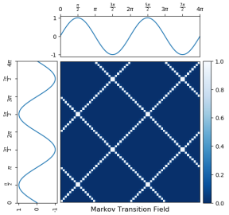
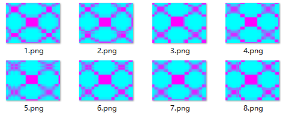
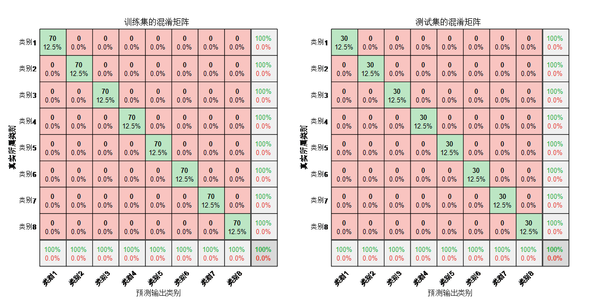
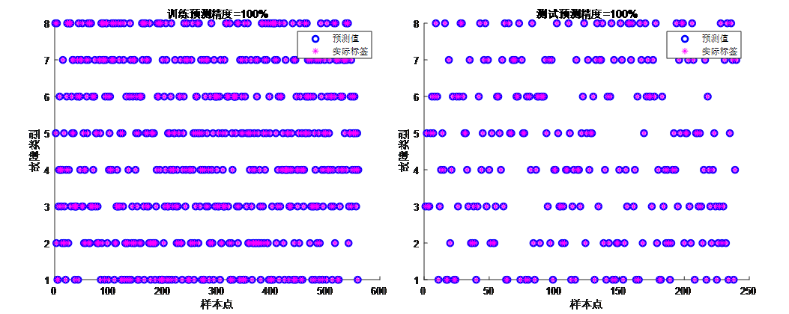
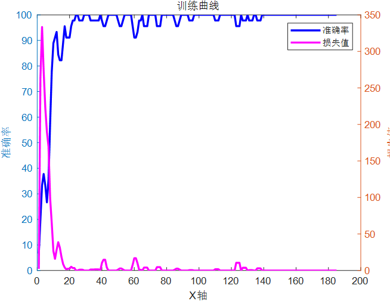

# Online First Release: MTF-CNN-Attention - Fault Identification/Classification Program Based on the Merging of Markov Transitional Field and Convolutional Neural Network with Multi-Head Self-Attention Mechanism

Applicable Platforms: MATLAB 2023 and Above
Content:
1. An Excel-formatted fault dataset
2. A time-series to image conversion program with Markov Transition Field (MTF)
3. A resolution modification program
4. A CNN-Attention fault diagnosis program.

Applicable Fields: Suitable for various data classification scenarios, such as rolling bearing faults, transformer oil gas faults, power system transmission line fault areas, insulators, distribution networks, and disturbances in electric power quality, etc., for identification, diagnosis, and classification of faults.

Literature Innovation Points: The innovation of this literature lies in the combination of Markov Transition Field (MTF) and Convolutional Neural Network (CNN), incorporating multi-head attention mechanisms to achieve fault classification. MTF converts one-dimensional signals into two-dimensional feature maps, while CNN can perform adaptive feature extraction and classification on these feature maps. The integration of multi-head attention mechanisms effectively captures the contribution of extracted features, achieving accurate fault classification.

Fault Identification Process:
Principle: Markov Transition Field (MTF) is a method for converting time series data into spatial image data. This method extends the Markov State Transition Matrix by expressing the transition matrix in sequence, fully preserving the discrete temporal dynamic information. Finally, fuzzy kernel aggregation is used to generate two-dimensional images. Taking the voltage sinusoidal signal as an example, the MTF schematic is shown in the figure below.

MTF-CNN-Attention for fault identification has several innovative aspects:
Data Representation Innovation: Typically, one-dimensional sequences (such as time series data) are directly used for modeling and analysis. Transforming these sequences into Markov field images is a novel data representation method. This transformation may reveal new patterns and structural features in the sequence data that might not be as apparent or detectable in their original one-dimensional form. It can more effectively capture complex patterns and anomalies than traditional time series analysis methods.
Image Processing Technology: By converting sequential data into images, mature image processing techniques and image recognition algorithms can be utilized to analyze the data. This includes employing various image recognition methods such as Convolutional Neural Networks (CNN), which have proven highly effective in the field of image analysis but are not commonly used in traditional sequential data analysis.
Capture Time-Dependence: Markov Fields are a mathematical model used to represent the dependence between random variables. When converting sequence data into Markov Field images, time-dependent and dynamic changes within the time series can be captured in the form of images, providing a new perspective for understanding and identifying fault patterns in time series.
Multi-head Attention Mechanism: This mechanism effectively captures the contribution of feature extraction, focusing on enhancing key features to improve the accuracy of fault identification.
Program application: Markov Transitional Field (MTF) generates two-dimensional images from one-dimensional time series, and then uses Convolutional Neural Networks (CNN) to extract high-dimensional features of the images. The Multihead Self-Attention mechanism is utilized to focus on the key features, thereby enhancing the accuracy of fault identification.
Input data format: (Each line represents a sample, the last column indicates the category label of the fault)
\n Generate MTF image based on the above data:
\n        \n  
Identification results: (Confusion matrix for training set and test set)
\nTraining set and test set scatter plots:
\n        \n  
Training Curve: Accuracy and Loss Change Graph
\n        \n  

## Images

<!-- PAYMENT_BLOCK -->

## Get this dataset

- Payment link (Stripe): [Buy now](https://buy.stripe.com/3cs8yP7sY87d0vu9AB)
- Payment QR code: 

<!-- /PAYMENT_BLOCK -->
